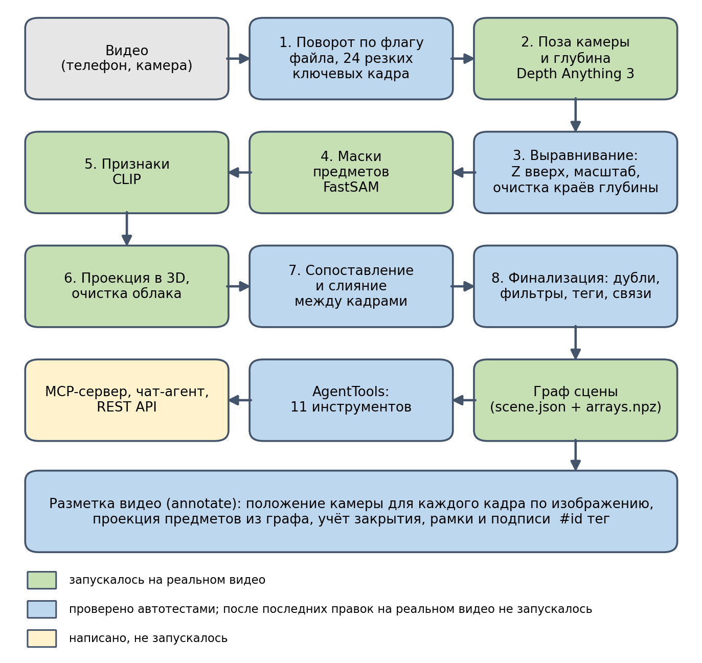
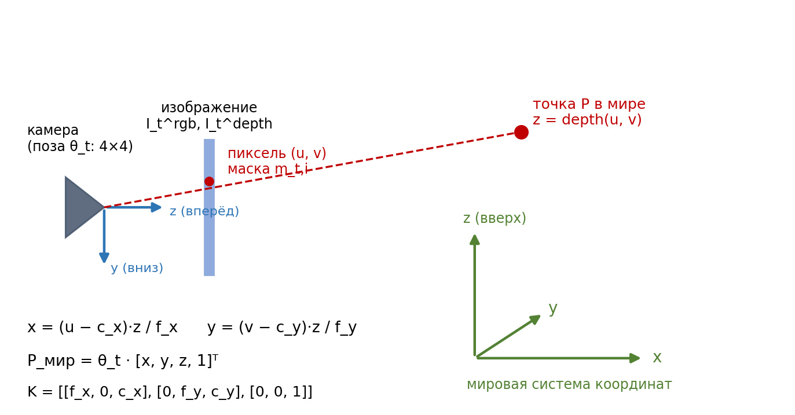
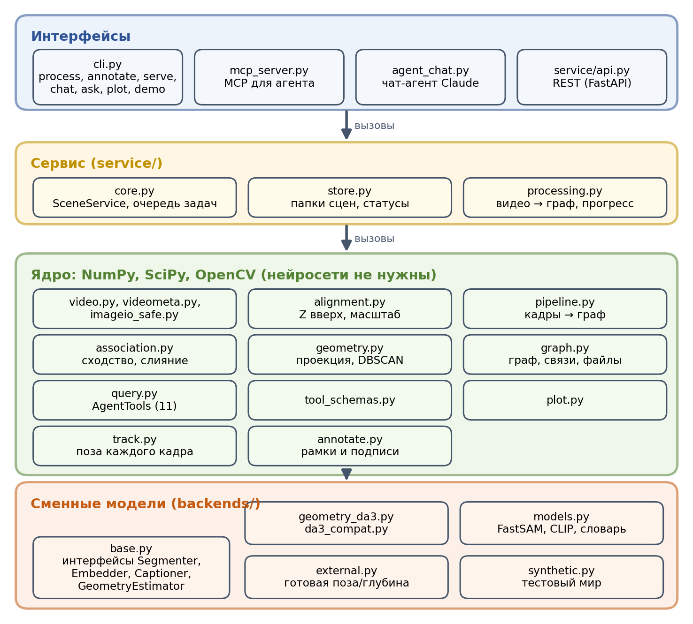
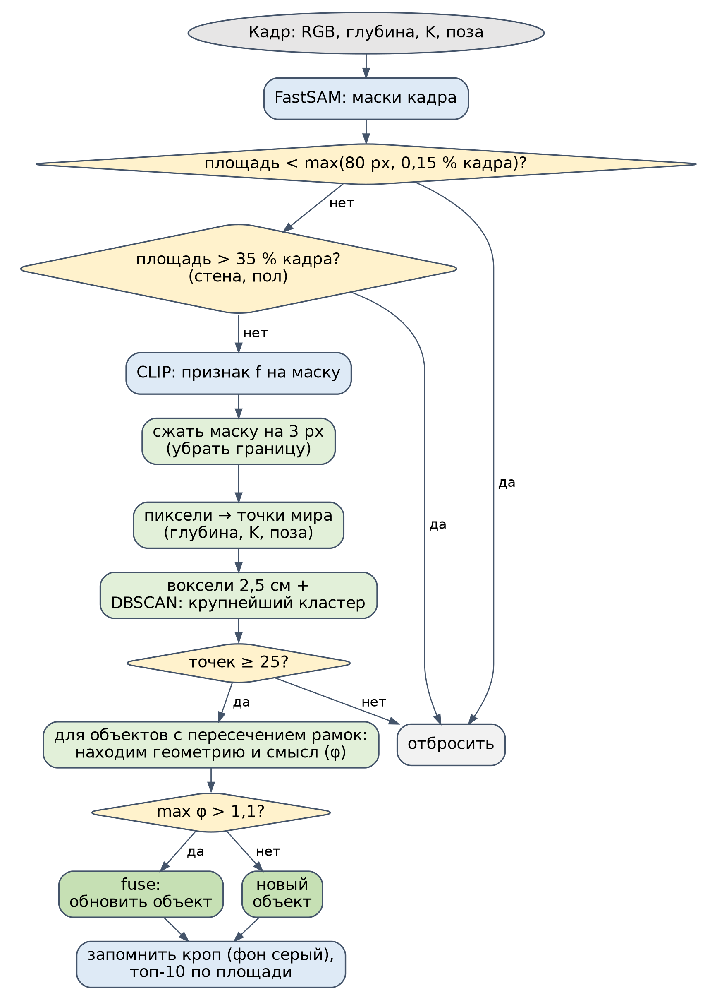
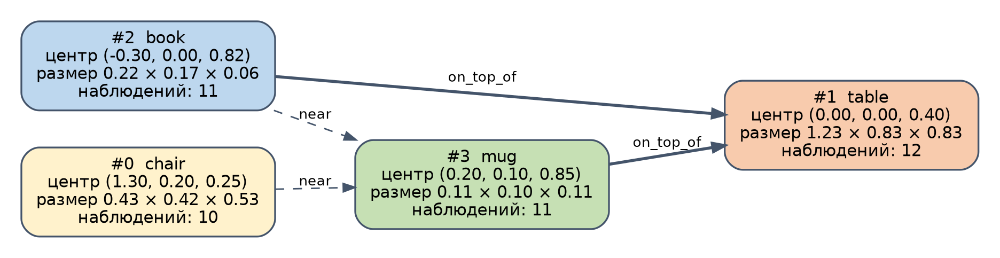
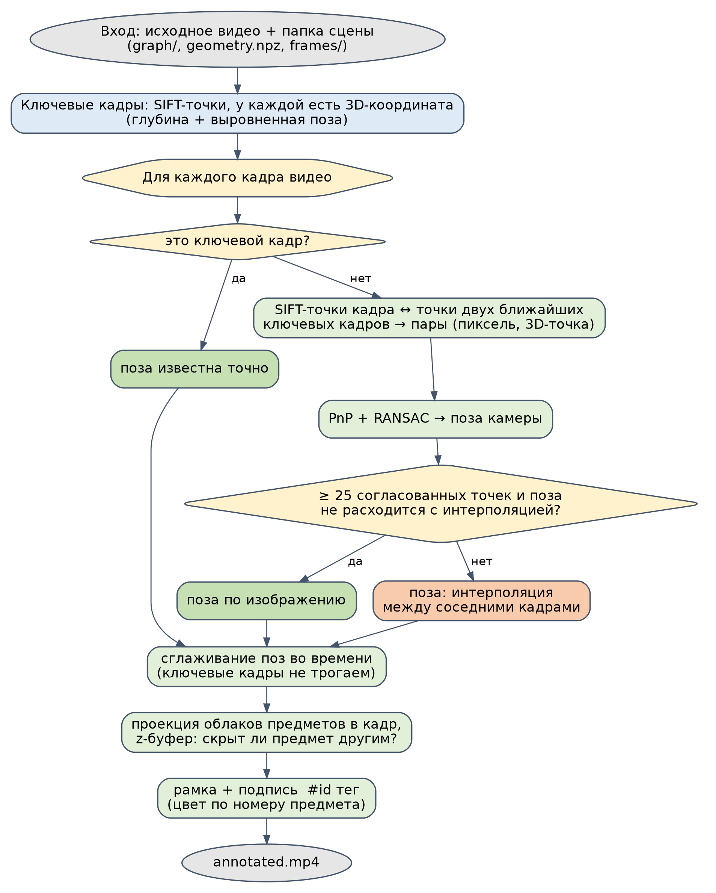
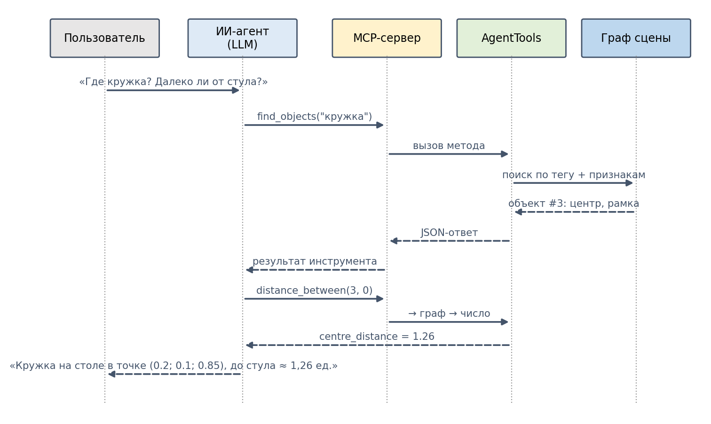
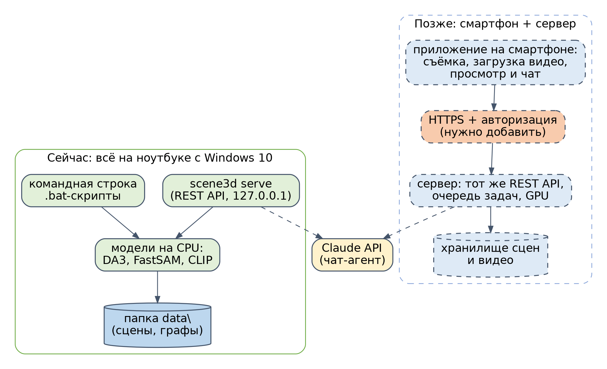

::: {custom-style="Title"}
scene3d: 3D-карта предметов из видео и работа с ней через ИИ-агента
:::

::: {custom-style="Subtitle"}
Полная документация. Версия 0.3, 29 октября 2026
:::

::: {custom-style="TocTitle"}
Содержание
:::

::: {custom-style="TocLine"}
1\. Назначение и текущее состояние

2\. Быстрый старт на Windows 10

3\. Теоретическая основа

4\. Архитектура

5\. Конвейер обработки видео, этап за этапом

6\. Разметка видео подписями

7\. Слой ИИ-агента: инструменты, MCP, чат, REST API

8\. Данные и форматы файлов

9\. Параметры и настройка

10\. Установка и эксплуатация на Windows

11\. Тестирование и что проверено

12\. Устранение неполадок

13\. Ограничения и риски

14\. Путь к смартфону и серверу

15\. Дорожная карта

16\. Глоссарий
:::

# 1. Назначение и текущее состояние

## 1.1. Задача

Приложение принимает обычное видео с телефона или камеры, без датчика глубины, и строит **список предметов с их положением в трёхмерном пространстве**. С результатом можно работать тремя способами:

- получить копию видео, на котором предметы обведены рамками и подписаны (`#номер тег`);
- задавать вопросы ИИ-агенту: «где кружка», «что лежит на столе», «далеко ли от стула до стола»;
- подключить к списку своё приложение через REST API (в перспективе это приложение на смартфоне).

Для каждого найденного предмета хранятся:

- номер (`id`) и тег (например, `mug`);
- положение центра и размеры охватывающей рамки в 3D;
- облако точек поверхности и вектор признаков (для поиска по описанию);
- связи с другими предметами: «лежит на», «внутри», «рядом»;
- служебные данные: сколько раз и в каких кадрах предмет наблюдался, статус «присутствует/пропал».

## 1.2. Методика

Основа взята из литературного обзора (разделы 1.2 и 3) и опирается на подход ConceptGraphs: сцена хранится не как плотное облако точек с признаками на каждую точку, а как **граф объектов**. Это экономит память и позволяет агенту рассуждать над компактным описанием сцены. Реализованы маски без привязки к категориям, признаки CLIP, проекция масок в 3D по глубине и позе, сопоставление объектов между кадрами по сумме геометрической и смысловой близости, обновление признаков бегущим средним, склейка дублей и связи по геометрическим правилам.

Главное отличие от обзора, вызванное исходным условием: у обычного видео нет глубины и позы камеры. Эти данные вычисляет модель **Depth Anything 3** (small, около 0,08 млрд параметров, лицензия Apache 2.0). По набору кадров она выдаёт относительную глубину, позы и матрицы камеры. Поэтому масштаб карты условный, пока он не откалиброван по известному расстоянию (раздел 7.4).

## 1.3. Конвейер и честный статус

Схема ниже показывает весь путь от видео до ответов агента. Цвет блока означает, насколько он проверен: зелёный блок запускался на реальном видео, голубой проверен автотестами, но после последних правок на реальном видео ещё не запускался, жёлтый написан, но не запускался.

{width=12.5cm}

: Таблица 1. Что запускалось на реальном видео

| Блок | Состояние |
|----------------------|----------------------------------------------------------|
| Depth Anything 3 (поза, глубина) | Запускался на CPU ноутбука с Windows. Прямой проход по 24 кадрам размером 280×504 занял около 45 секунд (одно наблюдение) |
| FastSAM (маски), CLIP (признаки), теги по словарю | Запускались, дали результат |
| Проекция, сопоставление, граф | Запускались. Первый прогон дал 328 «объектов» вместо десятков, причины найдены и исправлены (раздел 11.3) |
| Исправления после первого запуска | Поворот видео, фильтры масок и краёв глубины, трекинг позы камеры: проверены только на синтетике |
| Разметка видео | Запускалась на реальном видео, обнаружила поворот на 90° и ошибки положения, исправлена; после исправления не запускалась |
| MCP-сервер, чат-агент, REST API | Написаны, не запускались |

# 2. Быстрый старт на Windows 10

Подробности по каждому шагу в разделе 10. Здесь только порядок действий. Проект должен лежать в папке с латинским путём, например `D:\scene3d`.

1. **Установите Python 3.12** (64-бит) и Git for Windows. Python 3.14 не подходит: Depth Anything 3 его не поддерживает.
2. **Один раз выполните установку:**
   ```bat
   cd D:\scene3d
   windows\setup.bat
   windows\install_da3_deps.bat
   ```
3. **Проверьте установку без моделей:**
   ```bat
   windows\run_tests.bat
   windows\run_demo.bat
   ```
   Должно быть `OK` и картинка `plan.png` с четырьмя предметами.
4. **Обработайте видео** (латинский путь, лучше `.mp4`):
   ```bat
   windows\process_video.bat D:\scene3d_videos\room.mp4 24
   ```
   Результат в папке `data\scene1`: граф, ключевые кадры, `plan.png`, `process_info.json`.
5. **Получите видео с подписями:**
   ```bat
   windows\annotate_video.bat data\scene1
   ```
6. **Подключите агента:** чат (нужен API-ключ) или MCP (раздел 7).

# 3. Теоретическая основа

## 3.1. Постановка задачи

Система обрабатывает последовательность наблюдений: цветное изображение, карта глубины и поза камеры:

::: {custom-style="Equation"}
$$I_t = \langle I_t^{\text{rgb}}, I_t^{\text{depth}}, \theta_t \rangle, \qquad \theta_t \in SE(3)$$
:::

Результатом является граф сцены $M = \langle O, E \rangle$, где $O = \{o_j\}_{j=1}^{J}$ это объекты, а $E$ это связи между ними. Каждый объект хранит облако точек $p$, усреднённый вектор признаков $f$, подпись $c$ и охватывающую рамку $\mathbf{B}$:

::: {custom-style="Equation"}
$$o_j = \langle p_{o_j}, f_{o_j}, c_{o_j}, \mathbf{B}_{o_j} \rangle$$
:::

## 3.2. Проекция пикселей в 3D

Пиксель $(u, v)$ с глубиной $z$ переводится в точку камеры, затем в мировые координаты (рисунок 2). Здесь $K$ это матрица внутренних параметров камеры с фокусными расстояниями $f_x, f_y$ и центром $c_x, c_y$:

::: {custom-style="Equation"}
$$x = \frac{(u - c_x)\,z}{f_x}, \qquad y = \frac{(v - c_y)\,z}{f_y}, \qquad P_{\text{мир}} = \theta_t \cdot [x,\ y,\ z,\ 1]^T$$
:::

{width=14cm}

Обратная операция (точка мира в пиксель кадра) используется при разметке видео: $P_{\text{кам}} = \theta_t^{-1} P_{\text{мир}}$, $u = f_x x / z + c_x$, $v = f_y y / z + c_y$.

## 3.3. Сопоставление нового наблюдения с объектом

Когда в кадре найдена маска и построено её облако точек $p_{t,i}$ с признаком $f_{t,i}$, оно сравнивается с каждым известным объектом $o_j$. Оценка складывается из двух частей.

**Геометрическая близость** показывает, какая доля точек нового облака лежит рядом с точками объекта:

::: {custom-style="Equation"}
$$\phi_{\text{geo}}(i,j) = \frac{\left|\{x \in p_{t,i} \mid \min_{y \in p_{o_j}} \|x - y\|_2 < \tau\}\right|}{|p_{t,i}|}$$
:::

**Смысловая близость** это косинусное сходство признаков, приведённое к диапазону от 0 до 1:

::: {custom-style="Equation"}
$$\phi_{\text{sem}}(i,j) = \frac{1}{2}\left(\frac{f_{t,i}^{T} f_{o_j}}{\|f_{t,i}\|_2 \, \|f_{o_j}\|_2}\right) + \frac{1}{2}, \qquad \phi(i,j) = \phi_{\text{geo}}(i,j) + \phi_{\text{sem}}(i,j)$$
:::

Наилучший объект принимается, если $\phi > \delta_{\text{sim}}$ (по умолчанию 1,1), иначе создаётся новый.

**Адаптивный допуск (отличие от обзора).** В обзоре порог $\tau$ фиксирован (2,5 см). Для монокулярной глубины, где поверхности из разных кадров не совпадают идеально, здесь допуск растёт с размером объектов, но определяется **меньшим** из двух:

::: {custom-style="Equation"}
$$\tau = \max\bigl(\delta_{\text{nn}},\ 0{,}05 \cdot \min(\text{diag}(p_{t,i}),\ \text{diag}(p_{o_j}))\bigr), \qquad \delta_{\text{nn}} = 0{,}03$$
:::

Здесь $\text{diag}$ это диагональ охватывающей рамки облака. Крупные поверхности (стол, диван) получают больший допуск и склеиваются, несмотря на ошибку позы. При этом кружка не «съедается» столом, на котором стоит: допуск определяется кружкой и остаётся малым.

## 3.4. Обновление объекта

Признак объекта обновляется бегущим средним по числу наблюдений $n$:

::: {custom-style="Equation"}
$$f_{o_j} \leftarrow \frac{n_{o_j}\, f_{o_j} + f_{t,i}}{n_{o_j} + 1}$$
:::

В реализации результат дополнительно нормируется до единичной длины. Облака точек объединяются и прореживаются по сетке вокселей (2,5 см).

## 3.5. Выравнивание сцены

Модель реконструкции возвращает произвольную систему координат (обычно связанную с первой камерой) и произвольный масштаб. Остальная система предполагает, что ось Z направлена вверх, а расстояния соизмеримы с метрами. Выравнивание состоит из трёх операций (раздел 5.3): поворот так, чтобы оценённый вектор «вверх» $\mathbf{u}$ совпал с осью Z, сдвиг по высоте, и масштабирование:

::: {custom-style="Equation"}
$$R\,\mathbf{u} = (0, 0, 1)^T, \qquad s = \frac{2{,}0}{\operatorname{median}(z_{\text{depth}})}$$
:::

Это **не** метрическая калибровка: значение 2,0 это правдоподобная типичная дальность в комнате. Метры появляются после калибровки по известному расстоянию.

## 3.6. Положение камеры для произвольного кадра

Для кадров между ключевыми положение камеры находится по самому изображению. Точки SIFT текущего кадра сопоставляются с точками ближайших ключевых кадров, у которых известна 3D-координата (глубина плюс выровненная поза). Из пар «пиксель кадра $\leftrightarrow$ точка мира» поза находится решением задачи PnP с отбраковкой выбросов RANSAC. Если надёжной привязки нет, поза интерполируется: поворот сферической интерполяцией (SLERP), положение линейно.

## 3.7. Объём памяти

Плотные карты признаков требуют памяти порядка $O(V \cdot d)$ ($V$ число вокселей, $d$ размерность признака). Объектная карта требует порядка $O(J \cdot d + V_{\text{geom}})$, где $J \ll V$ число предметов. Для комнаты это десятки предметов вместо миллионов вокселей.

# 4. Архитектура

## 4.1. Слои

Код разделён на четыре слоя: интерфейсы, сервис, ядро и сменные модели. Ядро написано на NumPy, SciPy и OpenCV и не зависит от нейросетей. Нейросети подключаются через интерфейсы и заменяются без правок конвейера. Сервисный слой владеет очередью задач и папками сцен и нужен REST API. Общий объём кода около 2200 строк, тестов около 480.

{width=14cm}

: Таблица 2. Назначение модулей

| Модуль | Назначение |
|----------------|----------------------------------------------------------|
| `datatypes.py` | Классы `Frame`, `Detection`, `ObjectNode` |
| `geometry.py` | Проекция пикселей в 3D, воксели, очистка DBSCAN, пересечение рамок |
| `association.py` | Оценка сходства с адаптивным допуском, выбор объекта, слияние, диагностика |
| `graph.py` | Граф сцены: объекты, склейка дублей, связи, калибровка масштаба, сохранение |
| `pipeline.py` | Обработка кадров, фильтры, финализация карты, диагностика |
| `alignment.py` | Выравнивание «Z вверх», масштаб, очистка краёв глубины |
| `video.py` | Выбор резких ключевых кадров, индексы кадров в исходном видео |
| `videometa.py` | Чтение флага поворота из MP4/MOV без внешних утилит |
| `imageio_safe.py` | Windows-безопасный ввод-вывод изображений, `VideoReader` с правильным поворотом |
| `track.py` | Положение камеры для каждого кадра по изображению (SIFT + PnP) |
| `annotate.py` | Проекция предметов в кадры, учёт закрытия, рисование подписей, запись видео |
| `plot.py` | Вид сверху и сбоку для быстрой проверки результата |
| `query.py` | Класс `AgentTools`: 11 инструментов запросов |
| `tool_schemas.py` | Схемы инструментов для API Claude, строятся из сигнатур |
| `agent_chat.py` | Чат-агент: цикл вызова инструментов (Anthropic Messages API) |
| `mcp_server.py` | MCP-сервер с теми же инструментами |
| `service/processing.py` | Полный путь «видео → граф» с отчётом о ходе |
| `service/store.py`, `core.py` | Папки сцен, очередь задач, статусы (`SceneService`) |
| `service/api.py` | REST API на FastAPI |
| `backends/*` | Интерфейсы моделей, Depth Anything 3, FastSAM, CLIP, тестовый мир |
| `cli.py` | Команды `process`, `annotate`, `serve`, `chat`, `ask`, `plot`, `demo`, `frames` |

## 4.2. Сменные модели

Конвейер работает с четырьмя интерфейсами (`backends/base.py`). Чтобы подключить другую модель, достаточно реализовать нужные методы.

: Таблица 3. Интерфейсы моделей

| Интерфейс | Методы | Реализации |
|-------------|----------------------------|--------------------------------------------|
| `GeometryEstimator` | `estimate(rgbs)` возвращает кадры с глубиной, `K` и позой | `DepthAnything3Geometry`, `SyntheticGeometry` (тест) |
| `Segmenter` | `segment(rgb)` возвращает булевы маски | `FastSamSegmenter`, `SyntheticSegmenter` |
| `Embedder` | `embed`, `embed_crops`, `embed_text` возвращают единичные векторы | `ClipEmbedder`, `SyntheticEmbedder` |
| `Captioner` | `describe(crops)` возвращает (тег, подпись) | `VocabCaptioner` (по словарю), `SyntheticCaptioner` |

# 5. Конвейер обработки видео, этап за этапом

## 5.1. Чтение видео и выбор кадров

**Ориентация.** Видео с телефона хранится «лёжа» вместе с флагом «показывать повёрнутым». OpenCV учитывает этот флаг не во всех сборках, и на практике кадры читались боком, из-за чего вся обработка и итоговое видео были повёрнуты. Теперь `videometa.mp4_rotation` читает флаг из заголовка дорожки (`tkhd`) самого файла, не загружая видеоданные (служебный блок iPhone лежит в конце файла). `VideoReader` отключает автоповорот OpenCV и поворачивает кадры сам ровно один раз, поэтому результат не зависит от сборки OpenCV. Для файлов не в формате MP4/MOV (например, AVI) поворот равен нулю. Угол можно задать вручную: `--rotate 0|90|180|270` (по часовой стрелке).

**Кадры.** `sample_keyframes` читает видео подряд, пробует каждый третий кадр, делит видео на $N$ равных промежутков (по умолчанию 24) и в каждом берёт самый резкий кадр (дисперсия лапласиана). Это отсеивает смазанные кадры, типичные для съёмки из рук. Длинная сторона кадра уменьшается до 640 пикселей. Запоминаются индексы выбранных кадров в исходном видео, частота кадров и размер: они нужны при разметке.

## 5.2. Поза камеры и глубина

`DepthAnything3Geometry` отдаёт модели все кадры сразу. Модель обрабатывает их совместно и возвращает для каждого глубину, карту уверенности, внешние параметры (мир в камеру, матрица 3×4) и внутренние параметры. Программа инвертирует внешние параметры в позу «камера в мир», обнуляет глубину там, где уверенность ниже 20-го процентиля кадра или значение не конечно, и приводит кадр к разрешению карты глубины.

Допущение, принятое по документации модели и напрямую не проверенное: внешние параметры заданы в соглашении OpenCV (x вправо, y вниз, z вперёд). Если карта получается зеркальной, смотрите именно сюда. На ноутбуке без видеокарты время прямого прохода растёт с числом кадров и их размером, поэтому значения `--frames` 16–32 разумны для CPU.

**Импорт без лишних зависимостей.** Пакет Depth Anything 3 при импорте тянет модули для рендера гауссовых сплатов (`gsplat`), которые на Windows без видеокарты не ставятся. Они нам не нужны, поэтому `da3_compat.import_da3` подставляет безвредные заглушки для таких модулей. Любой другой недостающий модуль вызывает обычную ошибку.

## 5.3. Выравнивание сцены

Модуль `alignment.py` выполняет четыре действия (`ProcessConfig.auto_up`, `scale_target_depth`, `edge_filter`):

1. **Вертикаль.** Первая оценка берётся из камер: ось «вниз» камеры (y в соглашении OpenCV) при съёмке из рук указывает примерно на пол, поэтому «вверх» это минус среднее этих осей. Затем оценка уточняется RANSAC по самой большой почти горизонтальной плоскости облака (пол, стол, потолок): 400 итераций, допустимое отклонение от первой оценки 35°, допуск 1 % диагонали сцены, плоскость принимается, если на ней не менее 3 % точек, затем уточнение по инлайерам методом SVD.
2. **Поворот и сдвиг.** Мир поворачивается так, чтобы вертикаль стала осью Z. Затем сцена сдвигается по высоте так, чтобы 2-й процентиль высот точек стал нулём (низ сцены на уровне нуля).
3. **Масштаб.** Глубина и перемещения камеры умножаются на коэффициент, при котором медиана глубины равна 2,0. Это нужно потому, что пороги конвейера (воксель 2,5 см и др.) рассчитаны на метры.
4. **Края глубины.** Монокулярная модель «размазывает» глубину на границах предметов, и появляются длинные шлейфы из «летающих» точек (хорошо видны на виде сверху). Поэтому глубина обнуляется там, где соседние пиксели различаются больше чем на 6 % (плюс кольцо в один пиксель вокруг).

Угол между первой оценкой вертикали и уточнённой записывается в `process_info.json` (`tilt_deg`), коэффициент масштаба в `scale_factor`.

## 5.4. Маски и признаки

`FastSamSegmenter` возвращает маски без привязки к категориям. Для каждой маски `ClipEmbedder` вырезает прямоугольник с запасом 10 % и получает единичный вектор признаков. Тот же CLIP кодирует и текст запросов, поэтому описание предмета сравнивается с признаками напрямую. Все модели (Depth Anything 3, FastSAM, CLIP) работают на одном устройстве: на видеокарте NVIDIA (`cuda`), если она есть и установлен соответствующий torch, иначе на CPU. Устройство можно задать ключом `--device`.

## 5.5. Проекция масок в 3D и очистка

Обработка одной маски показана на рисунке 4. Сначала отбрасываются неподходящие маски: слишком мелкие (меньше большего из 80 пикселей и 0,15 % площади кадра) и слишком крупные (больше 35 % кадра: стены, пол). Затем маска сжимается на 3 пикселя, чтобы убрать пограничное кольцо с ненадёжной глубиной (если после сжатия остаётся меньше 30 % маски, берётся исходная). Пиксели с допустимой глубиной переводятся в мировые координаты, прореживаются по вокселям 2,5 см, и DBSCAN (радиус 6 см, минимум 5 точек) оставляет самый крупный кластер. Если точек меньше 25, маска пропускается.

{width=10.5cm}

## 5.6. Сопоставление и слияние

Для каждой маски вычисляется оценка $\phi$ со всеми присутствующими объектами карты (раздел 3.3). Чтобы не считать лишнего, сначала проверяется пересечение рамок с запасом $\tau$: если рамки не пересекаются, объект исключается. Если лучшая оценка выше 1,1, объект обновляется функцией `fuse`, иначе создаётся новый. Для каждого объекта запоминаются до 10 вырезок кадра с самыми большими масками. Вырезки сохраняются **с серым фоном вне маски**: иначе тонкий предмет (книга на столе) описывался бы по окружению, и подпись получала бы стол.

## 5.7. Завершающая обработка

После всех кадров выполняется цепочка шагов (`Pipeline.finalize`), каждый уменьшает число объектов:

1. **Склейка дублей.** Объединяются пары с пересечением рамок (IoU) больше 0,3 и косинусным сходством признаков больше 0,8. Повторяется, пока есть что склеивать.
2. **Фильтр по числу наблюдений.** Объект, виденный меньше чем в 3 кадрах (`min_obs`), удаляется: настоящий предмет виден многократно, а случайные обломки масок единожды.
3. **Фильтр по размеру.** Объекты с диагональю рамки больше 3,0 единиц удаляются (остатки стен и пола).
4. **Теги.** `VocabCaptioner` усредняет признаки вырезок объекта и выбирает ближайшее слово словаря по CLIP (подсказка «a photo of a слово»). В словаре 36 слов: бытовые предметы плюс «wall», «floor», «ceiling», «curtain», «cabinet», «painting». Объекты с тегами `wall`, `floor`, `ceiling` удаляются как конструкции, а не предметы для взаимодействия.
5. **Связи** (раздел 5.8).

## 5.8. Расчёт связей

Связи строятся в два шага. Сначала берётся минимальное остовное дерево по расстояниям между центрами (структурные соседи). Затем добавляются все пары, где найдено отношение опоры или вложенности. Для пары $(a, b)$ правила такие (вертикаль задаётся вектором `up`, после выравнивания это ось Z):

: Таблица 4. Правила определения связей

| Связь | Условие |
|-------------|----------------------------------------------------------|
| `on_top_of` («лежит на») | рамки пересекаются в горизонтальной проекции, нижняя грань $a$ совпадает с верхней гранью $b$ с допуском 15 % от большей высоты, и $a$ не ниже $b$ |
| `inside_of` («внутри») | рамка $a$ целиком лежит внутри рамки $b$ |
| `near` («рядом») | остальные пары из остовного дерева |

Зеркальные отношения (`below`, `contains`) переводятся в каноническую форму: «стол под кружкой» записывается как «кружка на столе». Пример результата на тестовой сцене показан на рисунке 5.

{width=16.5cm}

## 5.9. Диагностика

После обработки консоль печатает блок `--- diagnostics ---` (он же сохраняется в `process_info.json`). Он показывает, **на каком шаге** карта теряет или раздувает объекты, и нужен, чтобы настраивать пороги по данным, а не наугад.

: Таблица 5. Как читать диагностику

| Показатель | Что означает |
|----------------------|----------------------------------------------------------|
| `masks`, `too_big`, `too_few_points` | сколько масок поднято в 3D, сколько отброшено как слишком крупные и как слишком скудные |
| `merged_into_existing`, `new_objects` | сколько наблюдений склеено с существующим объектом и сколько создало новый. Если новых много, а склеенных мало, склейка не работает |
| `no_overlap` | маски, у которых рамка не пересеклась ни с одним объектом: объект действительно новый или позы кадров не согласованы |
| `median_best_geo`, `median_best_sem` | медианы геометрической и смысловой близости лучшего кандидата: показывают, что ломает склейку, геометрия или признаки |
| `frac_geo_above_0.15` | доля сопоставлений с заметным геометрическим пересечением |
| `candidates`, `after_merge`, `after_min_obs`, `after_size_filter`, `final` | число объектов после каждого шага финализации |

# 6. Разметка видео подписями

## 6.1. Что делает модуль

`annotate.py` создаёт копию исходного видео, на которой каждый предмет из карты обведён рамкой с подписью `#номер тег`. Цвет задаётся номером предмета, поэтому один и тот же предмет всегда окрашен одинаково. Результат: `data\scene1\annotated.mp4`. Для работы нужна обработанная сцена с файлом `geometry.npz` (позы сохраняются, начиная с версии 0.3).

{width=11.5cm}

## 6.2. Положение камеры для каждого кадра

Положение камеры точно известно только для ключевых кадров (24 из тысяч кадров видео). Для остальных есть два способа.

**Интерполяция** (быстро, приблизительно): поворот SLERP, положение линейно между соседними ключевыми кадрами. Она предполагает равномерное движение камеры. При съёмке из рук это неверно, и на неравномерном движении ошибка составляет десятки сантиметров: рамки уезжают с предметов и опаздывают или опережают видео. На синтетическом неравномерном облёте ошибка интерполяции была 5–32 см.

**Трекинг по изображению** (по умолчанию, точнее): `track.py` вычисляет SIFT-точки каждого ключевого кадра и по глубине получает их 3D-координаты. Для кадра между ключевыми точки сопоставляются с двумя ближайшими ключевыми кадрами (отношение расстояний 0,75), и поза находится PnP с RANSAC (300 итераций, допуск 3 пикселя) и уточнением методом Левенберга и Марквардта. Привязка принимается при не менее 25 согласованных точках и если поза не расходится с интерполяцией больше чем на 1,0 единицу или 40°. Остальные кадры заполняются интерполяцией между отслеженными, затем позы слегка сглаживаются по времени (окно 5 кадров, ключевые кадры не меняются). На синтетическом тесте ошибка отслеженных кадров была 0,6–3 см и менее 1°.

Консоль после разметки печатает, сколько кадров отслежено: `N keyframes, M tracked from the image, K interpolated, R rejected`. Если `tracked` мало, подписи между ключевыми кадрами будут приблизительными: увеличьте число ключевых кадров при обработке (`--frames 32`).

## 6.3. Видимость предмета

Предмет подписывается только если он виден. Для этого все облака объектов проецируются в грубый буфер глубины (в четверть разрешения, с фильтром минимума 5×5, который закрывает промежутки между редкими точками). Точка предмета считается закрытой, если перед ней в этом пикселе есть точка **другого** предмета. Собственная обратная сторона предмета в расчёт не берётся: иначе крупные предметы, обрезанные краем кадра, пропадали бы. Предмет подписывается, если видимо не менее 30 % его передней поверхности. Рамка строится по 2–98 процентилям видимых точек. Минимальный размер рамки зависит от разрешения (около 1,2 % длинной стороны кадра, не менее 6 пикселей), показываются не более 30 подписей на кадр.

Ограничение: закрытие считается только по предметам из карты. Стена, человек и всё, чего в карте нет, преградой не считаются.

## 6.4. Использование

```bat
windows\annotate_video.bat data\scene1
windows\annotate_video.bat data\scene1 cup,bottle
scene3d annotate data\scene1 --keyframes
scene3d annotate data\scene1 --no-track
scene3d annotate data\scene1 --depth
```

Первая команда подписывает все предметы, вторая только выбранные теги (через запятую, без пробелов). Ключ `--keyframes` размечает только ключевые кадры (точные позы) и сохраняет PNG в `data\scene1\annotated`. Ключ `--no-track` включает быструю интерполяцию вместо трекинга, `--depth` добавляет в подпись расстояние от камеры.

Видео пишется кодеком MPEG-4 (`mp4v`). Если плеер его не открывает, откройте файл в VLC или перекодируйте: `ffmpeg -i annotated.mp4 -c:v libx264 -pix_fmt yuv420p out.mp4`. На Windows подписи рисуются шрифтом Segoe UI (запасной Arial), поэтому поддерживаются и нелатинские теги.

# 7. Слой ИИ-агента: инструменты, MCP, чат, REST API

## 7.1. Как это устроено

Агент не смотрит видео и не обращается к нейросетям: он работает с готовым графом через инструменты. Класс `AgentTools` реализует их как обычные методы Python, принимающие и возвращающие данные, пригодные для JSON. Три интерфейса используют **одни и те же** инструменты: MCP-сервер, чат-агент внутри приложения и REST API.

## 7.2. Инструменты

: Таблица 6. Инструменты агента

| Инструмент | Параметры | Что возвращает |
|----------------------|------------------------|--------------------------------------------|
| `list_objects` | `include_missing` | все предметы: `id`, тег, положение, размеры, число наблюдений, статус |
| `get_object` | `object_id` | карточка предмета и его связи |
| `find_objects` | `query`, `top_k` (5) | предметы по описанию с оценкой совпадения |
| `where_is` | `query` | лучший найденный предмет, его положение и связи |
| `distance_between` | `id_a`, `id_b` | расстояние между центрами и зазор между рамками |
| `objects_near` | `object_id`, `radius` | предметы в заданном радиусе, по возрастанию расстояния |
| `get_relations` | `object_id` | связи: «на», «под», «внутри», «содержит», «рядом» |
| `scene_summary` | нет | число предметов, границы сцены, связи в виде предложений |
| `mark_missing` | `object_id` | помечает предмет как отсутствующий, пересчитывает связи |
| `update_position` | `object_id`, `new_center` | переносит предмет в новую точку, пересчитывает связи |
| `calibrate_scale` | `id_a`, `id_b`, `real_distance_m` | масштабирует карту так, чтобы расстояние между центрами стало реальным |

Инструменты `mark_missing`, `update_position` и `calibrate_scale` меняют карту и сразу сохраняют её на диск. Остальные только читают.

{width=16.5cm}

## 7.3. Поиск по описанию

Оценка совпадения предмета складывается как $0{,}6 \cdot \text{лексика} + 0{,}4 \cdot \text{смысл}$. Лексика это доля слов запроса, найденных в теге и подписи. Смысл это косинусное сходство текстового признака запроса с признаком предмета (если подключён CLIP). В выдачу попадают предметы с положительной оценкой.

Практический вывод: теги **английские**, и запросы нужно формулировать по-английски. Агент должен переводить запрос до вызова инструмента и отвечать пользователю на его языке. Команда `scene3d ask` ищет только по словам (CLIP не загружает).

## 7.4. Единицы измерения и масштаб

Каждый ответ содержит поле `units`. Пока масштаб не откалиброван, там указано, что единицы условные, и агент не должен называть расстояния метрами. Чтобы получить метры, пользователь называет одно известное расстояние, например «от стола до стула два метра». Агент вызывает `calibrate_scale`, после чего `metric_scale` становится истинным и все координаты пересчитываются.

## 7.5. MCP-сервер

Запускается командой `scene3d-mcp`, путь к графу задаётся переменной `SCENE3D_GRAPH`, CLIP для текстовых запросов включается `SCENE3D_CLIP=1`. Пример настройки клиента (`claude_desktop_config.json`, обратные слэши в JSON удваиваются):

```json
{
  "mcpServers": {
    "scene3d": {
      "command": "D:\\scene3d\\.venv\\Scripts\\scene3d-mcp.exe",
      "env": {
        "SCENE3D_GRAPH": "D:\\scene3d\\data\\scene1\\graph",
        "SCENE3D_CLIP": "1"
      }
    }
  }
}
```

В Claude Desktop MCP-режим работает по обычной подписке клиента и не требует API-ключа. Для других клиентов смотрите их условия.

## 7.6. Чат-агент в приложении

`agent_chat.ChatAgent` реализует цикл вызова инструментов через Anthropic Messages API: модель просит инструмент, программа выполняет его, возвращает результат, и так до окончательного ответа (не более 8 шагов). Ошибка инструмента возвращается модели как результат с пометкой ошибки, а не роняет цикл. Нужен пакет `anthropic` и ключ API в переменной `ANTHROPIC_API_KEY`. Модель задаётся переменной `SCENE3D_MODEL` (по умолчанию `claude-sonnet-5-5`).

**Ключ API** это строка вида `sk-ant-...`, получаемая в консоли разработчика на platform.claude.com (раздел API Keys). API оплачивается отдельно от подписки: нужен предоплаченный баланс. Задайте ключ командой `setx ANTHROPIC_API_KEY "sk-ant-..."` и откройте новое окно консоли. Никогда не вставляйте ключ в код и не отправляйте его в чаты. Запуск: `windows\run_chat.bat`.

Встроенная инструкция агента требует: в начале разговора вызвать `scene_summary`; переводить запросы на английский; не называть метры, пока масштаб не откалиброван; перечислять кандидатов при неоднозначности; менять карту только по просьбе или подтверждению пользователя.

## 7.7. REST API

Запускается командой `scene3d serve` (по умолчанию `127.0.0.1:8000`, интерактивная документация на `/docs`). Это контракт, к которому позже подключится приложение на смартфоне.

: Таблица 7. Маршруты REST API

| Метод и путь | Назначение |
|--------------------------------|--------------------------------------------------|
| `GET /api/health` | проверка работы сервера |
| `POST /api/scenes` | загрузка видео (multipart: `video`, `name`), возвращает `scene_id`; обработка идёт в фоне |
| `GET /api/scenes`, `GET /api/scenes/{id}` | список сцен; статус, стадия и прогресс одной сцены |
| `DELETE /api/scenes/{id}` | удаление сцены |
| `GET /api/scenes/{id}/objects` | все предметы сцены |
| `GET /api/scenes/{id}/objects/{oid}` | один предмет и его связи |
| `GET /api/scenes/{id}/summary` | сводка сцены |
| `POST /api/scenes/{id}/find` | поиск по описанию (`query`, `top_k`) |
| `POST /api/scenes/{id}/calibrate` | калибровка масштаба (`id_a`, `id_b`, `real_distance_m`) |
| `POST /api/scenes/{id}/chat` | вопрос агенту (`message`), нужен ключ API |
| `GET /api/scenes/{id}/plot.png` | вид сверху и сбоку |
| `POST /api/scenes/{id}/annotate`, `GET .../annotated.mp4` | отрисовка и получение видео с подписями |

Статусы сцены: `created`, `queued`, `running`, `done`, `error`. Прогресс по стадиям: чтение кадров 0–5 %, геометрия 5–45 %, выравнивание 45–50 %, объекты 50–95 %, финализация 95–100 %. Обработка идёт в одном потоке (на CPU параллелизм не помогает), модели загружаются один раз при первой задаче. Ошибка обработки не останавливает сервер, а записывается в `error`.

# 8. Данные и форматы файлов

## 8.1. Папка сцены

После `scene3d process ... -o data\scene1` создаётся:

: Таблица 8. Содержимое папки сцены

| Путь | Содержимое |
|---------------------|----------------------------------------------------|
| `graph\scene.json` | метаданные графа: вертикаль, флаг масштаба, связи, объекты (теги, подписи, статус, счётчики). Читается человеком, UTF-8 |
| `graph\arrays.npz` | сжатые массивы: `p{id}` облако точек объекта, `f{id}` вектор признаков |
| `geometry.npz` | выровненные позы и параметры камеры ключевых кадров, нужны для разметки (ниже) |
| `frames\00000.png` ... | ключевые кадры (уже повёрнутые, в разрешении карты глубины) |
| `process_info.json` | параметры запуска и диагностика: `scale_factor`, `tilt_deg`, `rotation_applied`, `frame_size`, путь к видео, `diagnostics`, `config` |
| `plan.png` | вид сверху и сбоку (если задан `--plot`) |
| `annotated.mp4` | видео с подписями (после `annotate`) |

При работе через REST API папки сцен лежат в `data\<идентификатор>\`, где дополнительно есть `video.<расширение>` и `meta.json` (статус, стадия, прогресс, число объектов, ошибка).

## 8.2. Файл geometry.npz

: Таблица 9. Поля geometry.npz

| Поле | Содержимое |
|-----------------|----------------------------------------------------------|
| `poses_wc` | позы «камера в мир», массив $(N, 4, 4)$, **после** выравнивания и масштабирования |
| `K` | матрицы камеры $(N, 3, 3)$ в разрешении карты глубины |
| `hw` | высота и ширина карты глубины каждого кадра |
| `frame_index` | номер каждого ключевого кадра в исходном видео |
| `fps`, `total_frames` | частота и число кадров исходного видео |
| `orig_wh` | размер кадра исходного видео после поворота |
| `rotation` | применённый поворот (градусы по часовой стрелке) |
| `depth` | глубина ключевых кадров, `float16`, $(N, H, W)$, после очистки краёв и масштаба |

Сцены, обработанные версиями до 0.3, этого файла не имеют: их нужно обработать заново.

## 8.3. Основные классы

: Таблица 10. Классы данных (`datatypes.py`)

| Класс | Поля |
|-----------|------------------------------------------------------------|
| `Frame` | `index`, `rgb`, `depth`, `K`, `pose_wc` |
| `Detection` | `frame_index`, `mask`, `points` (очищенное облако в мире), `feature` |
| `ObjectNode` | `id`, `points`, `feature`, `n_obs`, `first_frame`, `last_frame`, `captions`, `tag`, `caption`, `status`; свойства `center`, `extent`, `bbox_min`, `bbox_max` |

Рамки осевые (AABB). Центр это середина рамки, размеры оцениваются по видимой поверхности и поэтому могут занижать размер скрытых частей.

# 9. Параметры и настройка

## 9.1. Параметры конвейера (PipelineConfig)

Расстояния заданы в единицах карты. Благодаря масштабированию (раздел 5.3) 1 единица примерно соответствует метру.

: Таблица 11. PipelineConfig

| Параметр | По умолчанию | Смысл и подсказки |
|-------------------|-----------------|-----------------------------------------------|
| `delta_nn` | 0,03 | нижняя граница допуска сопоставления; рост приводит к склейке разных предметов |
| `delta_sim` | 1,1 | порог слияния; ниже порог означает больше слияний, выше означает больше дубликатов |
| `voxel` | 0,025 | размер вокселя прореживания |
| `dbscan_eps` | 0,06 | радиус DBSCAN |
| `min_points` | 25 | минимум точек в кандидате |
| `min_mask_area`, `min_mask_frac` | 80 px и 0,0015 | минимальная площадь маски: абсолютная и доля кадра |
| `max_mask_frac` | 0,35 | маски крупнее этой доли кадра считаются стенами и полом |
| `erode_px` | 3 | сжатие маски перед проекцией |
| `min_obs` | 3 | минимум кадров, в которых виден объект |
| `max_extent` | 3,0 | максимальная диагональ рамки объекта |
| `drop_tags` | wall, floor, ceiling | теги, объекты с которыми удаляются |
| `max_depth` | без предела | отсечение дальних точек |
| `max_crops` | 10 | число вырезок на объект для тегов |
| `merge_iou`, `merge_sem` | 0,3 и 0,8 | пороги склейки дублей |
| `up` | (0, 0, 1) | направление «вверх» (после выравнивания всегда Z) |

## 9.2. Параметры обработки видео (ProcessConfig)

: Таблица 12. ProcessConfig

| Параметр | По умолчанию | Смысл |
|---------------------|----------------|------------------------------------------------|
| `rotate` | `None` | поворот кадров; `None` значит читать флаг из файла |
| `n_frames` | 24 | число ключевых кадров для реконструкции |
| `max_side` | 640 | длинная сторона ключевого кадра в пикселях |
| `auto_up`, `refine_up` | да, да | выравнивание вертикали и её уточнение по плоскости |
| `scale_target_depth` | 2,0 | целевая медианная глубина; `None` оставляет масштаб модели |
| `edge_filter`, `edge_rel_grad` | да, 0,06 | очистка краёв глубины и её порог |
| `save_keyframes` | да | сохранять ключевые кадры в `frames\` |

## 9.3. Параметры командной строки

: Таблица 13. Команды и ключи

| Команда | Ключи |
|----------------------------|--------------------------------------------------------|
| `scene3d process ВИДЕО` | `-o` папка результата, `--frames`, `--max-side`, `--geometry-model` (например `depth-anything/da3-base`), `--vocab` (теги через запятую), `--device` (cpu/cuda), `--plot`, `--min-obs`, `--delta-nn`, `--delta-sim`, `--rotate`, `--max-objects-plot` |
| `scene3d annotate СЦЕНА` | `--video`, `-o`, `--only`, `--keyframes`, `--depth`, `--no-track` |
| `scene3d serve` | `--data`, `--host`, `--port` |
| `scene3d chat ГРАФ` | интерактивный диалог с агентом |
| `scene3d ask ГРАФ "запрос"` | поиск без LLM |
| `scene3d plot ГРАФ` | `-o` файл картинки |
| `scene3d demo` | прогон на синтетической сцене |
| `scene3d frames ВИДЕО ПАПКА` | `--every` выгрузка каждого N-го кадра |

## 9.4. Переменные окружения

: Таблица 14. Переменные окружения

| Переменная | Назначение |
|----------------------|------------------------------------------------------------|
| `ANTHROPIC_API_KEY` | ключ API для чат-агента |
| `SCENE3D_MODEL` | модель для чат-агента (по умолчанию `claude-sonnet-5-5`) |
| `SCENE3D_GRAPH` | путь к графу для MCP-сервера |
| `SCENE3D_CLIP` | `1` включает CLIP для текстовых запросов в MCP-сервере |
| `PYTHONUTF8` | `1` задают скрипты `.bat`: вывод на русском без искажений |

# 10. Установка и эксплуатация на Windows

## 10.1. Требования

- Windows 10, 64-бит, 16 ГБ ОЗУ желательно, около 5 ГБ на диске (torch, модели);
- Python **3.10–3.13**, 64-бит. Рекомендуется 3.12. **Python 3.14 не подходит**: Depth Anything 3 его не поддерживает (первый реальный запуск на этом и упал);
- Git for Windows;
- проект и видео в папках с **латинским путём** (OpenCV на Windows не открывает видео по кириллическим путям; картинки обработаны безопасно, видео нет).

## 10.2. Установка

```bat
cd D:\scene3d
windows\setup.bat
windows\install_da3_deps.bat
```

`setup.bat` выбирает Python 3.12, затем 3.11, 3.10, 3.13 (но не 3.14), проверяет версию и при неподходящей останавливается. Затем ставит PyTorch для CPU, сам проект и дополнительные пакеты (FastSAM, CLIP, FastAPI, Anthropic, MCP), клонирует репозиторий Depth Anything 3 в `third_party` и ставит его. Если полная установка не удаётся (на Windows без видеокарты часто мешает xformers), скрипт повторяет установку без зависимостей.

`install_da3_deps.bat` довершает установку: список зависимостей репозитория Depth Anything 3 неполон, поэтому скрипт пробует импорт, смотрит, какого модуля не хватает, ставит его через pip и повторяет, пока импорт не пройдёт. В конце сообщение `DA3 import OK`.

## 10.3. Какое видео снимать

- **Движение:** медленно обходите предметы, 20–40 секунд, без резких поворотов. Движение камерой вокруг предметов важнее длины ролика.
- **Положение телефона:** вертикально или горизонтально, но не меняйте его по ходу съёмки. Флаг поворота читается автоматически.
- **Свет и сцена:** хороший свет, без движущихся людей и зеркал, предметы целиком в кадре, на стенах и мебели есть текстура (однотонные поверхности плохо отслеживаются).
- **Формат:** лучше `.mp4` с H.264. Видео iPhone в формате HEVC OpenCV может не прочитать; на iPhone включите *Настройки → Камера → Форматы → Наиболее совместимый* или перекодируйте файл (HandBrake или `ffmpeg -i in.mov -c:v libx264 -crf 23 -pix_fmt yuv420p -an out.mp4`).

## 10.4. PowerShell и командная строка

Команды в этом документе рассчитаны на PowerShell и cmd. Различия, на которых легко споткнуться: в PowerShell удаление папки это `Remove-Item -Recurse -Force .venv` (а `rmdir /s /q` работает только в cmd); скрипты запускаются как `windows\скрипт.bat`; комментарии в командах начинаются с `#` в PowerShell и с `::` в cmd, поэтому при копировании комментарии вставлять не нужно.

## 10.5. Время и память

На ноутбуке без видеокарты самый долгий шаг это прямой проход Depth Anything 3. В одном наблюдении 24 кадра размером 280×504 обработались за 45 секунд. Время и память растут с числом кадров и размером, точных зависимостей я не измерял. При нехватке памяти или слишком долгой работе уменьшайте `--frames` (до 16) и `--max-side` (до 480). Трекинг позы при разметке и сама отрисовка видео добавляют время, пропорциональное числу кадров видео: для быстрой проверки используйте `--keyframes`.

# 11. Тестирование и что проверено

## 11.1. Автотесты

Тестов 33 (`windows\run_tests.bat`), они запускаются без нейросетей и без сети. Реальных видео и моделей они не используют: вместо них синтетический мир из четырёх тел (стол, кружка и книга на нём, стул) с отрисованными кадрами и точной истинной позой. Идентичность предмета в нём кодируется цветом и проходит через те же интерфейсы, что и реальные модели.

: Таблица 15. Состав автотестов

| Файл (число тестов) | Что проверяется |
|--------------------------|----------------------------------------------------------|
| `test_core.py` (5) | число и теги предметов, точность положения (ошибка центра менее 8 см), связи «на», запросы агента, калибровка масштаба и сохранение |
| `test_service.py` (15) | путь «видео → граф» на сжатом видео; выравнивание наклонённого на 40° мира; очередь задач, статусы и ошибка на битом видео; цикл чат-агента (с подставным клиентом) и схемы инструментов; UTF-8 и кириллица в файлах и путях изображений; ясная ошибка на нелатинском пути видео; мусорные маски (стена, пятна, фрагменты); фильтр одиночных находок; фильтр краёв глубины; кружка не «съедается» столом |
| `test_annotate.py` (7) | закрытие предметов друг другом, предмет за камерой и фильтр `only`, интерполяция позы, рисование, рамка кружки совпадает с её настоящими пикселями на кадре (IoU), запись видео, ключевые кадры |
| `test_track.py` (6) | чтение флага поворота (0, 90, 180, 270) и отсутствие повторного поворота при любом поведении OpenCV; отслеженные кадры точнее интерполяции в разы на неравномерном движении; откат на интерполяцию для старой сцены |

## 11.2. Результаты на синтетике

На идеальной синтетической сцене все четыре предмета находятся ко второму кадру, лишних объектов нет, связи верны (кружка и книга лежат на столе). Ошибка центра в первом измерении составила 0,1–0,3 см, тесты требуют не более 8 см. Размеры слегка завышены (2–3 см) из-за особенностей тестового рендера. Это верхняя граница качества: на реальном видео маски неидеальны, признаки менее различимы, глубина зашумлена.

## 11.3. Что обнаружил первый реальный запуск

: Таблица 16. Находки реальных запусков и исправления

| Наблюдение | Причина | Исправление |
|------------------------|--------------------------------------|------------------------------------------|
| Установка Depth Anything 3 остановилась | в окружении был Python 3.14, не поддерживаемый моделью; скрипт молча взял самую новую версию | `setup.bat` выбирает 3.12/3.11/3.10/3.13 и проверяет версию |
| `No module named 'addict'` | список зависимостей репозитория неполон | `install_da3_deps.bat` ставит недостающие модули по одному в цикле; для `gsplat` подставляется заглушка |
| 328 «объектов» вместо десятков | шлейфы глубины на краях, стены и осколки масок как объекты, одиночные находки не отсеивались | очистка краёв глубины, фильтры масок, `min_obs`, фильтр размера и структурных тегов, диагностика |
| Подпись книги «стол» | вырезка вокруг тонкого предмета состояла из пикселей стола | вырезки с серым фоном вне маски |
| Видео с подписями повёрнуто на 90° | OpenCV не применил флаг поворота; всё считалось по боковым кадрам | чтение флага из файла, ручной поворот ровно один раз |
| Рамки не на месте и ошибка по времени | положение камеры между ключевыми кадрами интерполировалось | трекинг позы каждого кадра по изображению |

## 11.4. Что не проверено

Нужно проверить на вашем компьютере и реальном видео: результат карты после всех исправлений (число объектов, качество тегов), точность подписей и долю отслеженных кадров при разметке, работу MCP-сервера, чат-агента с реальным ключом и REST API. Допущение об осях `extrinsics` Depth Anything 3 (соглашение OpenCV) напрямую не проверялось. Признак ошибки: зеркальная карта или предметы, «разлетевшиеся» по пространству. Если это так, смотрите `backends/geometry_da3.py`.

# 12. Устранение неполадок

: Таблица 17. Типичные проблемы

| Симптом | Что делать |
|--------------------------|------------------------------------------------------|
| `requires a different Python: 3.14` | удалите `.venv` (`Remove-Item -Recurse -Force .venv`), установите Python 3.12, повторите `setup.bat` |
| `The .venv uses an unsupported Python` | то же самое: окружение создано на неподходящей версии |
| `No module named ...` при импорте Depth Anything 3 | запустите `windows\install_da3_deps.bat`; если остановился на модуле, пришлите последние строки |
| предупреждения `xformers`, `gsplat`, `HF Hub`, `register_new_resolver`, `torch.jit.script` | безвредны на CPU: xformers нужен только для видеокарты, остальное предупреждения библиотек |
| `Video path contains non-ASCII characters` | переместите видео в папку с латинским путём |
| `cannot open video` или `video has no readable frames` | видео в формате HEVC; перекодируйте в H.264 `.mp4` |
| кадры или итоговое видео повёрнуты | в консоли смотрите `rotation applied N deg`; задайте `--rotate 90` (или 180, 270) и обработайте заново |
| `geometry.npz not found` | сцена обработана версией до 0.3; обработайте видео заново |
| `source video unknown` | добавьте `--video путь` |
| объектов слишком много | увеличьте `--min-obs` (4–5); посмотрите блок диагностики; уменьшайте число лишних масок |
| объектов слишком мало или кружка слилась со столом | уменьшите `--min-obs` (2) и `--delta-nn` |
| подписи «плывут» между ключевыми кадрами | в консоли смотрите долю `tracked`; увеличьте `--frames` при обработке |
| `.mp4` с подписями не открывается | откройте в VLC или перекодируйте через ffmpeg (раздел 6.4) |
| чат: `ANTHROPIC_API_KEY is not set` | `setx ANTHROPIC_API_KEY "sk-ant-..."` и откройте новое окно консоли |
| ошибка авторизации API при оплаченной подписке | API оплачивается отдельно: пополните баланс в консоли разработчика |
| в PowerShell не работает `rmdir /s /q` | используйте `Remove-Item -Recurse -Force` |

# 13. Ограничения и риски

1. **Масштаб условный.** Монокулярное видео не определяет реальный размер. Приводим к правдоподобному (медианная глубина 2,0), метры только после калибровки.
2. **Относительная глубина.** Depth Anything 3 small даёт относительную глубину; ошибки на однотонных, блестящих и прозрачных поверхностях неизбежны. Модель большего размера (`--geometry-model depth-anything/da3-base`) точнее, но медленнее.
3. **Теги по словарю.** 36 слов вынуждают присваивать каждому предмету одно из них: чужие предметы получают ближайшее по смыслу слово. Для описательных подписей нужна визуально-языковая модель (LVLM).
4. **Динамика.** Движущиеся предметы и люди портят оценку позы и слияние. Проверка предмета по новому кадру и автоматическое обновление не реализованы; есть ручные `mark_missing` и `update_position`.
5. **Связи правилами.** Связи считаются геометрией, а не языковой моделью; агент может рассуждать поверх `get_relations`.
6. **Рамки осевые** и оцениваются по видимой поверхности.
7. **Закрытие при разметке** учитывает только предметы из карты (раздел 6.3).
8. **Трекинг** требует текстуры: на однотонных стенах точек мало, и кадры заполняются интерполяцией.
9. **Производительность.** KD-дерево строится заново для каждого сравнения: допустимо для десятков предметов, на больших сценах станет узким местом.
10. **Безопасность REST API.** Нет авторизации и HTTPS: сервер предназначен для локального запуска (`127.0.0.1`). Для использования из сети их нужно добавить.
11. **Один пользователь, одна сцена за раз.** Очередь задач однопоточная, сцены хранятся в локальной папке.

# 14. Путь к смартфону и серверу

Приложение на телефоне должно только снимать, отправлять видео и показывать ответы. Вся тяжёлая работа уже вынесена за REST API, поэтому менять ядро для этого не придётся (рисунок 8).

{width=15cm}

Что нужно добавить для переноса на сервер:

: Таблица 18. Работы для серверного развёртывания

| Что | Зачем |
|----------------------|------------------------------------------------------|
| HTTPS и авторизация | сейчас API открыт без паролей и предназначен только для локального адреса |
| Сжатие и докачка видео | телефон загружает большие файлы по нестабильной сети |
| Сервер с видеокартой | тогда `--device cuda` и модель Depth Anything 3 base дают результат заметно быстрее |
| Хранилище сцен | вместо локальной папки: диск или объектное хранилище, учёт пользователей |
| Несколько рабочих процессов | сейчас одна задача за раз; нужна общая очередь |
| Уведомления о готовности | вместо опроса статуса |
| Клиент для смартфона | съёмка с подсказками (скорость, свет), загрузка, просмотр списка, подписи на видео, чат |

# 15. Дорожная карта

: Таблица 19. Следующие шаги

| Шаг | Содержание |
|---------|--------------------------------------------------------------------------------|
| 1 | Повторить обработку реального видео после исправлений, по диагностике подобрать `min_obs`, `delta_nn`, `delta_sim`; проверить разметку и долю отслеженных кадров |
| 2 | Проверить MCP-сервер, чат-агент с реальным ключом и REST API |
| 3 | Подписи через LVLM (например, LLaVA через Ollama) вместо словаря |
| 4 | Метрический масштаб: оценка по известному размеру предмета или метрической модели глубины |
| 5 | Динамические сцены: проверка предмета по новому кадру, обновление карты |
| 6 | Ориентированные рамки, кэш KD-деревьев, оптимизация для больших сцен |
| 7 | Серверное развёртывание и клиент для смартфона (раздел 14) |

# 16. Глоссарий

: Таблица 20. Термины

| Термин | Значение |
|-------------|--------------------------------------------------------|
| Поза камеры | положение и ориентация камеры: матрица $4 \times 4$ «камера в мир» |
| Глубина | расстояние от камеры до поверхности вдоль оси взгляда для каждого пикселя |
| Относительная глубина | глубина с точностью до неизвестного масштаба |
| $K$ | матрица внутренних параметров камеры: фокусные расстояния и центр изображения |
| Ключевой кадр | кадр видео, для которого модель вычислила позу и глубину |
| Маска | набор пикселей кадра, принадлежащих одному предмету |
| Признак (эмбеддинг) | вектор чисел, описывающий внешний вид или текст; близкие векторы означают близкий смысл |
| CLIP | модель, сопоставляющая изображения и текст в общем пространстве признаков |
| FastSAM, SAM | модели, находящие предметы на кадре без знания их названий |
| Depth Anything 3 | модель, выдающая глубину и позы камеры по набору кадров |
| DBSCAN | кластеризация, отбрасывающая разреженные точки-выбросы |
| Воксель | маленький кубик пространства; прореживание оставляет одну точку на кубик |
| IoU | отношение объёма пересечения рамок к объёму объединения |
| SIFT | алгоритм поиска и описания характерных точек изображения |
| PnP, RANSAC | вычисление позы камеры по парам «пиксель и 3D-точка» и устойчивый отбор согласованных пар |
| SLERP | сферическая интерполяция поворотов |
| Z-буфер | карта глубины для определения, какой предмет ближе к камере |
| Граф сцены | предметы как узлы и пространственные отношения как рёбра |
| MCP | протокол, через который ИИ-агент вызывает внешние инструменты |
| LVLM, LLM | большая визуально-языковая и большая языковая модель |
| AABB | осевая охватывающая рамка |
